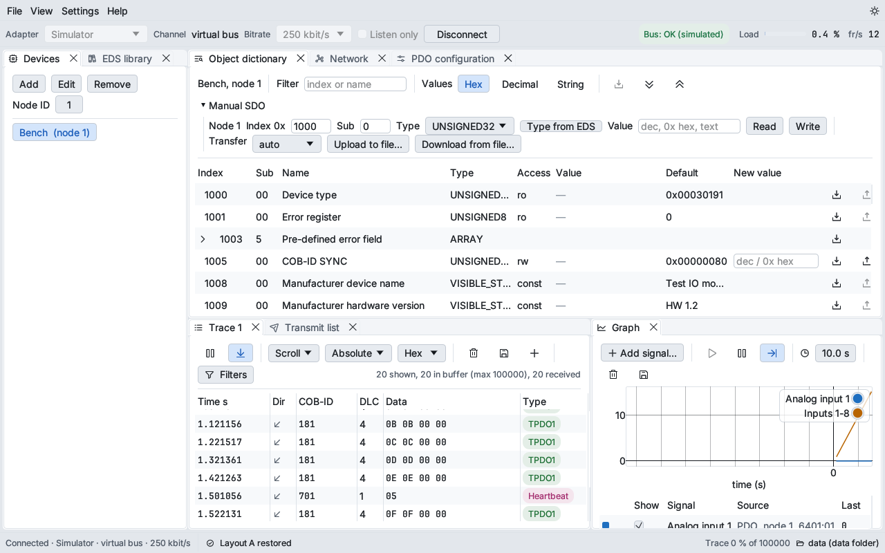

# CANoxide

A small, free Windows tool to test, configure and debug CANopen devices
on a bench. It works with a PEAK PCAN-USB adapter, an ifm CANfox, or with
no hardware at all through a built-in simulated node.

- **GUI** (`CANoxide.exe`): one portable exe of about 9 MB, or a standard
  Windows installer.
- **Command line** (`canoxide-cli.exe`): the same functions with JSON
  output, made for scripts and AI agents.

What it is for:

- **Talk to a device.** Load its EDS or DCF file, then read and write its
  objects by SDO (expedited, segmented and block transfer) from a tree of
  the object dictionary. A manual SDO box works without an EDS.
- **Watch the bus.** A live trace decodes NMT, SYNC, EMCY, heartbeat, SDO,
  PDO and LSS messages. With an EDS, SDO lines show object names and PDOs
  are split into their mapped signals. Switch the data view between hex,
  decimal and string; filter, pause, log to a file, save as CSV.
- **Plot values.** Graph PDO signals, SDO-polled objects or raw frame bits
  over time.
- **Configure a device.** Read and change its PDO configuration, set its
  node-ID and bit rate by LSS, save its configuration to a DCF, compare
  and restore it.
- **Control the network.** NMT start / stop / reset, node scan, network
  overview, SYNC, heartbeat set-up, and a transmit list of raw frames
  (manual, periodic or on reception).
- **Keep a library.** Named devices (node ID plus EDS) and your EDS files.
- **Try it without hardware.** The simulated node answers SDO, sends
  heartbeat and PDOs, reacts to NMT and LSS.

It is an independent open-source project, written in Rust with `egui`. It
is not affiliated with any commercial CANopen tool.




## Download

From the
[latest release](https://github.com/MechAkh/CANoxide/releases/latest),
Windows 10/11, 64 bit:

| File | Use |
|---|---|
| `CANoxide-x.y.z-setup.exe` | Installer with the usual setup wizard (Start menu entry, uninstaller, optional desktop shortcut and PATH entry for the command-line tool). |
| `CANoxide.exe` | Portable GUI: copy it anywhere and run it. |
| `canoxide-cli.exe` | Portable command-line tool. |

The files are not code signed, so Windows SmartScreen may warn on the
first start ("More info" then "Run anyway").

## Comparison with CANopen Magic Professional

CANopen Magic is the established commercial tool in this field. The table
compares the features of CANoxide 0.4 with those of CANopen Magic
Professional, taken from the vendor's public product pages in November
2026. Check the vendor's pages for the current and complete list.
CANoxide is younger and has had far less use on real networks.

| Feature | CANopen Magic Pro | CANoxide 0.4 |
|---|---|---|
| Price and licence | Commercial licence | Free, MIT, open source |
| EDS / DCF import, object dictionary browser | Yes | Yes |
| SDO read / write, expedited and segmented | Yes | Yes |
| SDO block transfer | Yes | Yes |
| SDO data to / from a file | Yes | Yes |
| Trace with CANopen decoding and filters | Yes | Yes |
| Several trace windows | Yes | Yes (up to 4 tabs) |
| Continuous logging to a file | Yes | Yes (CSV) |
| Log playback | Yes | Yes (CANoxide files and candump logs) |
| PDO decoding from the device's real configuration | Yes | Yes |
| PDO configuration window (read, edit, write) | Yes | Yes |
| Graphical display of process data over time | Yes | Yes |
| Process data gauges and instrument panels | Yes | No |
| Network overview (state, identity, last emergency) | Yes | Yes |
| NMT, node scan, heartbeat set-up | Yes | Yes |
| Bus load display | Yes | Yes |
| Transmit list (manual, periodic, on reception) | Yes | Yes (no keyboard triggers) |
| LSS master, including Fastscan | Yes | Yes |
| DCF save and restore of a node configuration | Yes | Yes, with compare and dry run |
| Dockable, movable windows | Yes | Yes |
| Dark and light themes | not stated | Yes |
| Command-line tool with JSON output for scripts and AI agents | Command-line options | Yes (`canoxide-cli`) |
| Built-in simulated node | Ultimate edition (full node simulation) | One simple node |
| Scripting inside the tool | Ultimate edition (Python) | No (use the command-line tool) |
| CAN FD / CANopen FD | Yes | No |
| CiA 447 and other application profiles | Yes | No |
| Error frame display | Yes | No |
| CAN interfaces | PEAK, Kvaser and others | PEAK PCAN-USB, ifm CANfox |
| Portable single exe | No (installer) | Yes, plus an installer |
| Vendor support, long field history | Yes | No |

## User interface

The window has a menu bar, a connection bar (adapter, channel, bitrate,
listen-only, Connect, **Scan nodes**, bus state and load) and a status bar.
**Scan nodes** starts the node scan of the Network view and opens that
view; while the scan runs, the bar shows its progress and a **Cancel scan**
button. The views are dock tabs; open and close them from the **View**
menu:

- **Devices** and **EDS library**: the named devices and the EDS/DCF files.
- **Object dictionary**: the object tree of the active device, read and
  write by SDO, the manual SDO box, upload and download of large objects.
- **Network**: NMT for one node or all, SYNC, node scan, heartbeat, and an
  overview of the nodes heard on the bus.
- **Trace 1..4**: up to four trace tabs on one shared buffer, each with its
  own filter, display mode and pause; save as CSV. With **Autoscroll** on,
  the view follows the newest frame; scroll up (wheel, Page Up, Home) and
  it stops; scroll back to the end (or End) and it follows again. With
  Autoscroll off, the visible rows stay in place while new frames arrive.
- **Messages**: one row per COB-ID with count, cycle time, DLC, the data
  bytes and the age. A byte that changed is tinted blue (value up) or red
  (value down) and fades out (fade time in Settings); **Mute noisy bytes**
  hides the tint of bytes that change on almost every frame. Select a row
  to see its bits (how often each bit toggles), the mapped PDO signals and
  their values; select bits and click **Add to Graph** to plot them as raw
  bits. Statistics reset for one row or for all. Signal analysis, see below.
- **Graph**: plot PDO signals (TPDOs and RPDOs of the device), SDO-polled
  values or raw frame bits; export as CSV. SDO polling runs only while you
  start it. The **Add signal** window can be moved, so that the plot stays
  visible.
- **PDO configuration**: read the PDOs of a node, edit, enable or disable
  them, save and load them from the library.
- **Transmit list**: saved raw frames, sent once, periodically or on
  reception of a COB-ID.
- **LSS**: switch state, inquire, fastscan, configure node-ID and bit
  timing.
- **DCF save / restore**: save a node to a DCF, compare a DCF with a node,
  dry run and restore.

**Log replay.** Choose **Log file (replay)** as the adapter and pick a
CANoxide trace CSV or a candump log (`(1700000000.123456) can0 181#0102`).
Connect loads the log (a log with bad lines asks first) and shows the
transport bar: play / pause, step, speed (0.25x to 16x or as fast as
possible), loop and a time scrubber. Every view works on the replayed
frames as on a live bus; nothing is sent. `canoxide-cli --adapter replay
--file <log>` does the same for scripts (see docs/CLI.md).

**Signal analysis** (Messages view, Graph, **Find signal** tab):

- **Define signal.** Drag over bits in the bit grid (also across byte
  borders; **LE** or **BE** sets the byte order of the selection) and click
  **Define signal...**: name, start bit, length, byte order, unsigned /
  signed / float32, factor, offset, unit and colour. User signals are kept
  per COB-ID in `user_signals.json`; they show as outlines and names in the
  grid, in the value list beside it (edit, delete), in the decoded text of
  the trace and as the **User signal** source of the Graph. They may overlap
  the PDO-mapped signals.
- **Find similar bits.** Select one bit (or use a 1-bit user signal) and
  rank every bit of the trace buffer, or of the loaded log up to the replay
  cursor, by how often it equals the reference (match) or its inverse
  (inverted match). Bits that never toggled are left out; click a row to
  select that bit. The search runs in the background and can be cancelled.
- **Find signal** (View menu): start with every bit field of the chosen
  sizes (default: single bits and byte-aligned 8, 16 and 32 bit fields,
  optionally only some COB-IDs), then keep the fields whose newest value
  (live or at the replay cursor) passes each step: = != > < between, or
  increased / decreased / changed / unchanged since the last step. **Undo
  step**, **Reset**, and **Define signal...** for a candidate. The start
  set is capped at 200 000 fields (a note says so).
- **Sparklines** of the last 10 s (Settings: Messages: sparkline time)
  beside each user signal and each mapped PDO signal in the Messages
  detail.
- **History** of the selected COB-ID under the bit grid: newest frame
  first, time, Δt, data and one column per signal, with a filter (signal,
  = != > <, value) and **Export CSV...** of the filtered rows.
- **Graph > Export range**: a CSV of a time range (from / to, default the
  visible range) with a `time_s` column and one column per signal; a cell
  is empty when that signal has no sample at that time.

**Docking.** Drag a tab to move or split it, so that several views are
visible at once. The first start picks layout A (window narrower than
1600 px) or layout B (wider, Network on the right); **View > Reset
layout** restores it. The layout is saved in `layout.json`; a broken file
gives the default layout with a note.

**Themes.** Dark, Light, or System (follows Windows); the button at the
right of the menu bar cycles them. Both themes meet the WCAG AA contrast
for text.

**Settings** (menu **Settings**): appearance (theme, UI scale, font size,
row density, zebra stripes, reduced colour), connection defaults, SDO,
LSS, scan, trace, graph and safety options (for example the confirmation
before a write); the Data folder page shows where the data is kept.
Changes apply on **Save**; **Cancel** keeps the saved values.

## Command line

`canoxide-cli.exe` is a command-line CANopen master for scripts and AI
agents, on the same library: scan, node info, SDO read/write (block
transfer included), OD dump, NMT, SYNC, raw frames, a bounded bus monitor,
PDO read/enable/set/map, heartbeat, value watch, LSS, DCF
save/restore/compare, and a `shell` that keeps one session open. Output is
JSON (JSON Lines for `monitor`, `watch` and `shell`); `--text` gives
tables. The simulator is the default adapter, and `--listen-only` refuses
every command that transmits.

```
canoxide-cli help --json
canoxide-cli scan
canoxide-cli sdo read 0x1018:1
canoxide-cli --adapter pcan --listen-only monitor --duration 10
```

Exit codes: 0 ok, 1 device/protocol error, 2 usage error, 3 adapter error.
See [docs/CLI.md](docs/CLI.md) for the safety model and worked examples.

## Safety

Nothing is sent unless you press a button or give a command. Connect only
opens the channel. "Listen only" opens the PCAN channel (or the CANfox
net, with the silent flag of the Sontheim driver) in listen-only
mode and disables every send control. The node scan sends one SDO request
at a time.

LSS and DCF restore change a device: a new node-ID or bit rate can take a
device off the bus, and a failed PDO change leaves that PDO disabled until
it is written again. The tool asks before these actions (see the Safety
settings).

The PEAK adapter has had only light use on real hardware; the CANfox
adapter was tested on one unit only. Try listen-only
mode on a bench bus before you rely on the tool on a live system.

## Data folder

All state of the GUI lives in one data folder: `settings.json`,
`devices.json`, `eds\` (copies of the added EDS/DCF files), the saved
PDO configurations, `layout.json` (the dock layout), `signals.json` (the
graph signals), `user_signals.json` (the user signals of the Messages
view) and `txlist.json` (the transmit list).

- **Portable:** `CANoxide_data\` next to the exe. A data folder of the old
  name (version 0.1) there is renamed to it on the first start.
- **Installed:** `%APPDATA%\CANoxide` (the installer puts a file
  `CANoxide.installed` next to the exe, which selects this folder).

If the folder is not writable, the app shows the error and saves nothing.
A broken `devices.json` is kept as `devices.json.bad`. The command-line
tool uses a data folder only when it gets `--data-dir`.

## PEAK driver

The PEAK adapter needs the PEAK driver with `PCANBasic.dll` (64 bit),
loaded at run time from `System32` or from the exe folder. Without it the
app still works (EDS browser, library, simulator) and the PEAK channel list
shows "driver not found". Channels: PCAN-USB 1..8.

## CANfox driver

The CANfox adapter needs the Sontheim / ifm CANfox driver installed (the
64-bit `SIECA164.DLL` of the Sontheim MT-API). It is looked for in the
path of the environment variable `CANOXIDE_SIECA_DLL`, then by name (the
Windows search), then in `Sontheim\MT_Api` under Program Files (x86) and
Program Files. Without it the app still works and the CANfox net list shows
the error. A `channel` is a net number: a CANfox is net 105. The adapter
never forces the bitrate of a net that another program (for example
CoDeSys) owns; when the driver does not answer, it stops after about 3 s
and asks you to close CoDeSys and restart the PC. Tested so far, on
one CANfox at 500 kbit/s: the net list, reception and one SDO read. It
is not known whether a CANfox in listen-only mode still
acknowledges frames.

## Build

Rust stable (MSVC), from this folder:

```
cargo test
cargo clippy --all-targets -- -D warnings
cargo build --release
```

The exes are `target\release\CANoxide.exe` and
`target\release\canoxide-cli.exe`: single files with a static CRT. Both
carry the app icon (`assets\icon\canoxide.ico`, compiled by `build.rs`
with the `winresource` crate and the `rc.exe` of the Windows SDK);
`py -3 tools\check_exe_icon.py` checks the built exes. The installer is
built with Inno Setup 6, see [installer/README.md](installer/README.md).

A Rust exe contains the source paths of its dependencies, and so the name
of your user folder. For a build that you publish, replace it (PowerShell):

```
$env:RUSTFLAGS = "-C target-feature=+crt-static --remap-path-prefix=$env:USERPROFILE=C:\Users\user"
cargo build --release
```

## Limits (not built)

- CAN FD.
- Firmware download (CiA 302-3) as a guided function (a block download of
  a file to an object is possible).
- Gauges, error frame display, application profiles such as CiA 447.
- Adapters other than PEAK, the CANfox and the simulator (the `CanAdapter` trait
  allows more backends later).

## Licence

MIT. See [LICENSE](LICENSE). The embedded fonts (Inter, JetBrains Mono)
are under the SIL Open Font License, see `licenses\`. The icons are
Phosphor icons (MIT).

No driver file of PEAK or Sontheim is part of CANoxide. Product and company
names in this file are trademarks of their owners and are used only to
describe compatibility.
